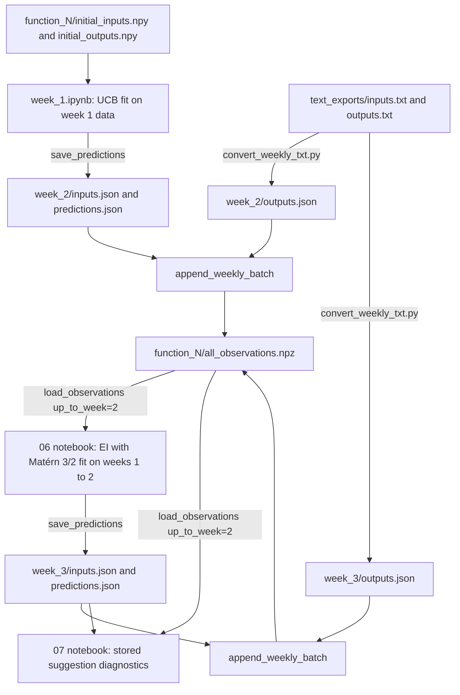

# Data flow

This document describes how data moves from the supplied arrays to the per-function observation files, and what each field means. Read it before changing any file in `data/`, `scripts/`, or the prediction notebooks.

## Week numbering

- Week 1 is the supplied initial data (`initial_inputs.npy` and `initial_outputs.npy`).
- The folder `data/weekly_updates/week_N/` holds the inputs evaluated in week $N$, their real outputs, and the predictions made before those evaluations.
- Predictions in `week_N` are made in week $N-1$, using only observations with `weeks` $\le N-1$.

## Overview

The cycle repeats for each new week: predictions are saved before evaluation, real outputs are added after evaluation, and the next suggestions use the updated aggregate.

## Stages

1. **Initial data.** The supplied `initial_inputs.npy` and `initial_outputs.npy` are never modified. [data/README.md](../data/README.md) lists the requirements. `load_observations` reads them only until the first aggregate exists.
2. **Suggest and predict.** A notebook fits a Gaussian process (GP) on the observations available at that point. `suggest_with_prediction()` returns `(point, mean, std, acquisition_score)`; capture `optimizer.acquisition_settings` alongside that result. The notebook calls `save_predictions` to write `inputs.json` and `predictions.json` to the next week's folder. The save step checks the values by reading the files back and, by default, refuses to replace existing files with different values. The historical suggestion notebooks explicitly use `overwrite=True` after checking that regenerated inputs match the submitted inputs.
3. **Evaluate (external).** The evaluator returns one real output per input. Results arrive as NumPy-printed text in `data/weekly_updates/text_exports/`, one list per week.
4. **Convert text to JSON.** [scripts/convert_weekly_txt.py](../scripts/convert_weekly_txt.py) writes `inputs.json` and `outputs.json` into each week folder. Identical files are reported as unchanged. Differing files are rejected unless `--overwrite` is given. List $i$ in a text file becomes week `--first-week` + $i$ (default first week 2). Row $j$ maps to function $j$ unless function IDs are passed explicitly.
5. **Import the batch.** `append_weekly_batch` reads `inputs.json`, `outputs.json`, and `predictions.json` together and appends the rows to each function's `all_observations.npz`. The week comes from the folder name (`week_N` gives week $N$). Re-importing identical rows is a no-op. Conflicting outputs or predictions are rejected.
6. **Reuse.** Notebooks call `load_observations(root, function_id, up_to_week=N)` to get the data available through week $N$. Analysis notebooks read the same aggregate.

## Field reference

### `data/function_N/initial_inputs.npy` and `initial_outputs.npy`

| Field | Shape | Meaning |
| --- | --- | --- |
| initial inputs | $(n, d)$ | Week 1 input points in $[0, 1)^d$. $d$ is the dimension of function $N$. |
| initial outputs | $(n,)$ or $(n, 1)$ | Real scalar outputs for the initial inputs. |

### `data/function_N/all_observations.npz`

This is the runtime source of truth for function $N$. Every array has one row per observation, in the same order.

| Field | Shape | Meaning |
| --- | --- | --- |
| `inputs` | $(m, d)$ | All evaluated points, initial and weekly. |
| `outputs` | $(m,)$ | Real evaluator output for each point. This is the only field that comes from the objective. |
| `expected_outputs` | $(m,)$ | GP posterior mean predicted for that point before it was evaluated. `NaN` for initial rows and for rows recorded without a prediction. |
| `stds` | $(m,)$ | GP predictive standard deviation at that point, in output units, from the same prediction. Nonnegative. `NaN` when missing. |
| `weeks` | $(m,)$ | Week label. `1` for initial data; `N` for rows imported from `week_N`. Files without this field are rejected until `scripts/add_week_labels.py` adds it. |

`expected_best_outputs` is not stored in this file. It exists only in the week's `predictions.json`.

### `data/weekly_updates/week_N/inputs.json`

A JSON array of points, one per function, in function order. Row $j$ is function $j$ (unless an explicit mapping is passed). Coordinates are rounded to six decimals. These are the points submitted for evaluation.

### `data/weekly_updates/week_N/outputs.json`

A JSON array of real evaluator outputs, in the same row order as `inputs.json`. Each value is a scalar.

### `data/weekly_updates/week_N/predictions.json`

A JSON object with three base prediction arrays and, in newly generated files, two acquisition arrays. All arrays have the same length and row order as `inputs.json`:

| Field | Meaning | How it is computed |
| --- | --- | --- |
| `expected_outputs` | Predicted output at the input before evaluation (the GP posterior mean). | Model prediction at the suggested point. |
| `stds` | Predictive standard deviation at the same point, in output units. | Model prediction at the suggested point. Finite and nonnegative. |
| `expected_best_outputs` | Expected best-so-far after evaluating that input. | $f^{*} + \mathrm{EI}_0(x)$, where $f^{*}$ is the best observed output available when the prediction was made (weeks $\le N-1$), and $\mathrm{EI}_0(x)$ is expected improvement with $\xi = 0$ computed from `expected_outputs` and `stds`. This equals $\mathbb{E}[\max(f(x), f^{*})]$ under a Gaussian predictive distribution. When `stds` is zero, it is $\max(f^{*}, \mu)$. |
| `acquisition_scores` | Configured acquisition score at the selected input, returned as the fourth value from `suggest_with_prediction()`. | EI using the selection `xi` and incumbent, or UCB using the selection `kappa`. UCB scores may be negative. |
| `acquisition_settings` | Settings defining each score. | An object per input: `{"name": "ei", "xi": ..., "best": ...}` or `{"name": "ucb", "kappa": ...}`. |

`expected_best_outputs` does not depend on the exploration parameter used to select the input (for example, $\xi = 0.1\,\mathrm{std}(y)$ in notebook 06). It uses $\xi = 0$ and is computed without refitting the model.

`acquisition_scores` instead preserves the configured selection score: Week 2 predictions use UCB with `kappa = 1.96`; Week 3 predictions use EI with each function's `XI_VALUES` entry. Scores and settings are optional for older files but must be supplied together. They remain tracking metadata in `predictions.json`, not columns in `all_observations.npz`. The suggestion notebooks verify regenerated coordinates against historical `inputs.json` before overwriting predictions.

`optimizer.acquisition_settings` supplies the same settings used by `predict()`: the configured `xi` and resolved incumbent `best` for EI, or `kappa` for UCB. It returns a fresh dictionary reflecting the current observations and configuration. Capture it alongside the selected score, before observing a new result or changing the configuration, as the suggestion notebooks do.

### `data/weekly_updates/text_exports/inputs.txt` and `outputs.txt`

NumPy-printed attachments from the evaluator. Each file holds one list per week, in week order. `inputs.txt` rows are written as `array([...])`. `outputs.txt` rows are plain numbers. The converter reads these and writes the JSON files above. They are archived, not edited.

## Producers and consumers

| File | Written by | Read by |
| --- | --- | --- |
| `initial_inputs.npy`, `initial_outputs.npy` | Supplied | `load_observations` (fallback), `week_1.ipynb` |
| `all_observations.npz` | `append_weekly_batch`, `append_observation`, `scripts/add_week_labels.py` | `load_observations`, all notebooks, analysis scripts |
| `week_N/inputs.json` | `save_predictions`; `convert_weekly_txt.py` | `append_weekly_batch`; stored-candidate diagnostics |
| `week_N/outputs.json` | `convert_weekly_txt.py` | `append_weekly_batch` |
| `week_N/predictions.json` | `save_predictions` | `append_weekly_batch`; stored-candidate diagnostics; expected-best progress plots |
| `text_exports/*.txt` | Evaluator (external) | `convert_weekly_txt.py` |

The code that does this work is in [src/bayesian_bbo/data.py](../src/bayesian_bbo/data.py) and [src/bayesian_bbo/acquisition.py](../src/bayesian_bbo/acquisition.py).

## Notebook producers

| Notebook | Data used | Writes |
| --- | --- | --- |
| [week_1/week_1.ipynb](../notebooks/week_1/week_1.ipynb) | Initial data (weeks $\le 1$). UCB with $\kappa = 1.96$ and a fixed RBF kernel. | `week_2/inputs.json`, `week_2/predictions.json`. The best-so-far for `expected_best_outputs` is the maximum of the initial outputs. |
| [week_2/06_all_functions_ei_matern32_suggestions.ipynb](../notebooks/week_2/06_all_functions_ei_matern32_suggestions.ipynb) | Data through week 2 (`up_to_week=2`). EI with Matérn 3/2, per-function length-scale caps, and hardcoded `XI_VALUES` originally chosen as $0.1\,\mathrm{std}(y)$. | `week_3/inputs.json`, `week_3/predictions.json`. The best-so-far is the maximum of weeks $\le 2$. |

## Stored and live diagnostics

[week_2/07_optimum_progress_before_optimizer.ipynb](../notebooks/week_2/07_optimum_progress_before_optimizer.ipynb) is a read-only consumer: it does not save suggestions or record evaluations. With `WEEK = 2`, it trains on observations through week 2 and reads the historical week 3 suggestion. It configures EI using the saved `xi` and incumbent `best`, with the Matérn 3/2 kernel and length-scale caps matching notebook 06. Saved UCB records are rejected by this EI-specific example.

The stored-candidate loop passes these fields to `plot_gp_2d` or `plot_gp_slices` in [src/bayesian_bbo/visualisation.py](../src/bayesian_bbo/visualisation.py):

| Plot argument | Source for the selected function |
| --- | --- |
| `candidate` | `inputs.json` |
| `expected_mean` | `predictions.json["expected_outputs"]` |
| `expected_std` | `predictions.json["stds"]` |
| `expected_ei` | `predictions.json["acquisition_scores"]`, not `expected_best_outputs` |

When all three prediction values are supplied, the helper does not predict at the candidate again. Mean and standard deviation must be supplied together; missing candidate predictions are computed with `optimizer.predict()`. The heatmaps, slice curves, and uncertainty bands always come from the currently fitted model, so they can differ from the saved marker values. Coordinate slices fix all other coordinates at the candidate, rather than projecting observations onto each axis.

The separate live example currently searches 100,000 candidates for Function 7 and passes the returned mean, standard deviation, and acquisition score directly to the same plot arguments. It does not read those marker values from JSON or overwrite historical files. Changing the candidate pool can select a different point even with identical training data and GP settings; this also changes the reference coordinates and therefore the slice curves. A higher EI score is not a measured improvement in the real objective.

[week_3/01_optimum_progress.ipynb](../notebooks/week_3/01_optimum_progress.ipynb) compares saved `expected_best_outputs` against actual best-so-far values from the observation history. These historical expectations must not be replaced by predictions fitted using the outcomes being compared.

## Rules to keep

- Never edit `all_observations.npz` by hand; use `append_weekly_batch` or `append_observation`.
- Save predictions before the evaluation they describe. Historical regeneration must preserve the original training cutoff and settings; never include the predicted point's outcome or later observations in that fit.
- `save_predictions` refuses to replace an existing `inputs.json` or `predictions.json` with different values, and checks both files before writing either. Pass `overwrite=True` only to replace the current week's files on purpose. Identical files can be rewritten.
- The historical suggestion notebooks use `overwrite=True` to regenerate predictions, but first assert that regenerated coordinates equal the existing submitted inputs. A candidate mismatch stops the save instead of replacing the historical submission. The plotting notebook does not perform this save step.
- Standard deviations must be nonnegative. Predictions and outputs must be finite.

## Known gaps

- `expected_best_outputs` is stored only in `predictions.json`, not in `all_observations.npz`.
- Saved acquisition settings describe score calculation, not the entire fitted model or search. Kernel configuration, seed, candidate count, and dependency versions are not recorded in those settings; retain the original notebook configuration when reproducing a suggestion.
- [data/README.md](../data/README.md) still says "function_1 through function_9"; the dataset has functions 1 to 8.
